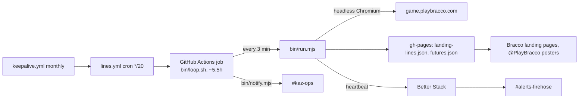

# bracco-lines ops

Part of the single-operator ops platform (jacobq61/ops). Alerts land in Element.

## Architecture

No server, so no `/api/health`. The health check is the feed itself:
https://jacobq61.github.io/bracco-lines/landing-lines.json (Better Stack keyword/freshness check, `ops/monitors/`).

## Alert routing

| Event | Where | Source |
|---|---|---|
| 3 failed reads in a row (~9 min) | #kaz-ops (warn) | `bin/loop.sh` |
| Recovered after 3+ failed reads | #kaz-ops | `bin/loop.sh` |
| 10 failed reads (~30 min), job fails | #kaz-ops + #alerts-firehose | `lines.yml` failure step |
| Job crashed, timed out or never started | #alerts-firehose via Better Stack | `HEARTBEAT_URL_BRACCO_LINES` stops |
| Feed URL down | #alerts-firehose via Better Stack | HTTP check |
| CI result on PRs | GitHub checks | `ci.yml` |

## Secrets inventory

Source of truth: GCP Secret Manager (`ops/secrets/manifest.yaml`), synced to GitHub Actions. Names only.

| Name | Where | Purpose |
|---|---|---|
| `GITHUB_TOKEN` | built in | push to gh-pages, keepalive |
| `MATRIX_HOMESERVER`, `MATRIX_BOT_TOKEN`, `MATRIX_ROOM_KAZ_OPS`, `MATRIX_ROOM_ALERTS_FIREHOSE` | GitHub Actions | alerts |
| `HEARTBEAT_URL_BRACCO_LINES` | GitHub Actions | Better Stack heartbeat |

All optional: unset means no alert, never a failed run.

## CI/CD

- `ci.yml` on PRs and main: `npm ci`, `npm run check` (syntax), `bash -n bin/loop.sh`, `npm test`.
- Deploy is the `lines.yml` job itself; merging to main changes the next queued run.
- Branch protection on main requires `CI / test` (`ops/github/harden.sh`).

## Runbook

| Symptom | Check | Fix |
|---|---|---|
| "3 failed reads" in #kaz-ops | Job log: `only N upcoming games` or a Playwright timeout | Off-season or slow site: wait. If game.playbracco.com changed layout, fix `src/domain/parse.mjs` against a saved page and `npm test` |
| Heartbeat missing, no job running | Actions tab: is `lines` disabled? | Run `keepalive` or `gh workflow enable lines.yml`; dispatch `lines` |
| Landing pages show matchups but no prices | Feed older than 6h | Same as above; the pages hide stale prices by design |
| Futures stale | `no futures read` in log | Outright page layout changed: `src/domain/futures.mjs` |
| Actions minutes exhausted | Billing | Run `node bin/run.mjs` from cron on any box with `OUT` set (README) |
